# MASAKRA na Starym Majdanie: Oficjalne Zasady Gry

## 1. Cel Gry
Wędrowycz-Gemini to gra strategiczna, w której gracze (Hersztowie) dowodzą czterema bandami: Wampirami, Wilkołakami, Duchami i Bardakami. Celem jest zdobycie jak największej liczby punktów zwycięstwa w ciągu 12 rund, unikając furii Jakuba Wędrowycza.

## 2. Elementy Gry
*   **Plansza:** Siatka 6x6 regionów, na której toczy się walka.
*   **Zastępy plugastw Nocy:** Wampiry (V), Wilkołaki (W), Duchy (G) oraz Bardaki (B) walczące o dominację.
*   **Jakub:** Unikalny pionek, który niszczy wszystko na swojej drodze.
*   **Panel Jakuba:** Boczny panel zarządzania statystykami i furią Jakuba Wędrowycza.
*   **Panel posiłków Band:** Panel wskazujący limit i stan pionków poszczególnych band na planszy.
*   **Zestawy (Taktyczne Oddziały Szturmowe):** Pojedyncze małe taktyczne oddziały szturmowe składające się z członków różnych band. Za wystawienie takiego oddziału na planszę hersztowie poszczególnych band otrzymują punkty zwycięstwa.

## 3. Przebieg Gry
Gra toczy się przez **12 rund**. Każda runda składa się z pięciu faz:

### Główne pojęcia

*   **Geometria Planszy (Sąsiedztwo i Odległość):**
    *   **Sąsiedztwo:** Dwa sektory sąsiadują ze sobą, jeśli stykają się wspólną krawędzią (bokiem) lub wspólnym rogiem. Sektory mogą mieć od 3 do 8 sąsiednich sektorów.
    *   **Odległość:** Odległość między sektorami mierzona jest w krokach. Przejście do dowolnego sąsiadującego sektora — w pionie, poziomie lub na ukos (po skosie) — zajmuje dokładnie 1 krok. Odległość między dwoma polami to najmniejsza liczba takich kroków, by dotrzeć z jednego do drugiego.
    *   **Odległość od Jakuba:** Dystans mierzony w krokach między polem, na którym stoi Jakub, a sektorem docelowym, w którym umieszczany jest zestaw.
*   **Hierarchia Band (Starszeństwo):**
    Rozstrzyga wszelkie sytuacje remisu w grze. Starszeństwo band od najwyższego do najniższego:
    **Wampiry > Wilkołaki > Duchy > Bardaki**
*   **Zasada Remisu:**
    W przypadku remisu (np. przy rozstrzyganiu punktów, wyborze celów Jakuba lub na koniec gry), postępujemy według **Hierarchii Band**.
*   **Furia (Gniew Jakuba):**
    Wskaźnik określający poziom agresji Jakuba wobec danej bandy. Każdy zlikwidowany przez niego pionek danej bandy zmniejsza furię na tę bandę o 1. Gdy furia spadnie do 0, Jakub przestaje ją ścigać i atakować. Oznacza to, że wartość furii wyznacza maksymalną liczbę pionków danej bandy, jaką Jakub może zabić w danej rundzie.
*   **Wizualizacja odległości:**
    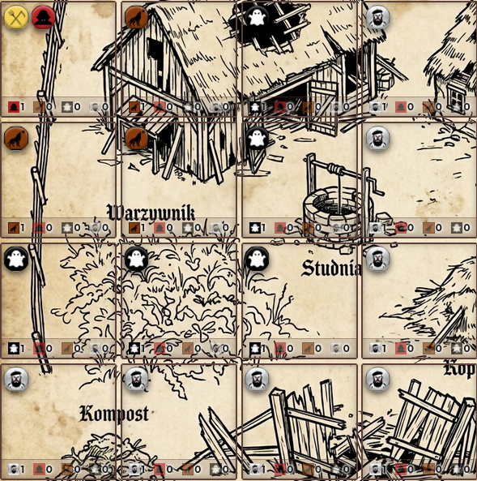
    *Przykłady odległości. Wampir jest w regionie z Jakubem czyli jest w odległości 0. Wilkołaki są w odległości 1, Duchy są w odległości 2, Bardaki są w odległości 3.*

### Faza I: Przygotowanie
1.  **Rozdysponowanie Zestawów:** Każdy gracz otrzymuje zestawy pionków z talii dobierania. Gracze dążą do posiadania optymalnych kombinacji jednostek.
2.  **Zasoby Jakuba:** Jakub również pobiera 2 zestawy, które zwiększą jego agresję w danej rundzie.
3.  **Punkty Początkowe:** W pierwszej rundzie każdy gracz zaczyna z 20 punktami.

### Faza II: Faza Hersztów (Wybór Dowództwa)
Na początku tej fazy wszyscy dotychczasowi Hersztowie wracają do wspólnej puli wyboru. Następnie gracze ustalają kolejność na podstawie bieżących punktów zwycięstwa. W odwrotnej kolejności – od gracza z najmniejszą liczbą punktów (ostatniego) do lidera (pierwszego) – każdy wybiera jednego wolnego Herszta (bandę). Wybrany Herszt decyduje o tym, za pionki której bandy gracz będzie otrzymywał punkty chwały (przy wystawianiu zestawów) lub tracił je (w przypadku czystki Jakuba) w bieżącej rundzie.

### Faza III: Faza Graczy
Gracze wykonują tury naprzemiennie (wg aktualnej kolejności):
1.  **Akcja:** Gracz może wystawić zestaw pionków w pustym regionie (pod warunkiem, że w puli posiłków znajduje się wystarczająca liczba pionków danej bandy, aby całkowicie skompletować oddział; w przeciwnym razie zagranie takiego zestawu jest niedozwolone) lub podkablować nim Jakubowi.
2.  **Punktacja Natychmiastowa (Rozproszona):** Punkty otrzymują wszyscy Hersztowie za pionki swojej bandy z wystawionego zestawu, zgodnie z logiką danej bandy. Gracz wystawiający nie musi otrzymać żadnych punktów, jeśli w zestawie nie ma pionków jego bandy.
3.  **Pasowanie:** Gracz może spasować. Musi wtedy odrzucić nadmiarowe zestawy (zostawiając max 3). Za każdy odrzucony zestaw otrzymuje +1 pkt, podkablowując nim Jakubowi (każdy pionek w zestawie zasila furię Jakuba na odpowiednią bandę).

### Faza IV: Faza Jakuba
Po spasowaniu wszystkich graczy, Jakub rusza do akcji:

1.  **Zasilanie Furii:** Jakub absorbuje zestawy pobrane na starcie rundy oraz te odrzucone przez graczy. Każdy pionek zwiększa Furię na daną bandę.
    *   **Zasięg:** Zasięg Jakuba to teraz **1 + liczba band, na które Furia wynosi co najmniej 10**.
    *   Maksymalny zasięg Jakuba to **5**.
2.  **Czystka:** Jakub zabija pionki w swoim regionie. Za każdego zabitego pionka, aktualny Herszt tej bandy traci 1 punkt (szczegółowe zasady i rozliczanie furii znajdują się w punkcie 6).
3.  **Ruch i Łowy:** Jakub skanuje regiony w swoim zasięgu i przemieszcza się do nowego sektora (szczegółowe zasady wyboru celu, ruchu i rozstrzygania remisów opisano w punkcie 6). Każdy ruch zmniejsza aktualny zasięg o 1 (minimum 1).
4.  **Koniec Fazy:**
    *   **Bonus za Przetrwanie:** Jeżeli po zakończeniu ruchu i czystki Jakuba, w jego aktualnym regionie znajdują się jakiekolwiek pionki graczy, ich aktualny Herszt otrzymuje **2 punkty bonusowe** za każdy taki pionek.
    *   **Reset Zasięgu:** Po zakończeniu akcji Jakuba, jego **zasięg wraca do 1**.
    *   Zestawy Jakuba trafiają na stos kart odrzuconych.
    *   **Rundy 1-9:** Hersztowie wracają do puli. Kolejność graczy: najmniej punktów = pierwszy.
    *   **Runda 10:** Gracze **zachowują** swoich Hersztów do ostatecznego punktowania.

### Faza V: Faza Wydarzeń
Odkrywamy wydarzenie, które wpływa na obecny stan planszy.

## 4. Zakończenie Gry i Punktacja Końcowa
Po zakończeniu fazy Jakuba w **10. rundzie**, następuje ostateczne podsumowanie. Gracze otrzymują bonusy za bandy, którymi dowodzili w ostatniej rundzie:
1.  **Wampiry:** 2 punkty za każdy region, w którym znajduje się co najmniej jeden wampir (niezależnie od ich liczby w danym regionie).
2.  **Wilkołaki:** 1 punkt za każdy swój pionek na planszy.
3.  **Duchy:** 2 punkty za każdy region, w którym są same; 1 punkt za każdy inny region, w którym mają Przewagę.
4.  **Bardaki:** 1 punkt za każdy region, w którym ma Przewagę (więcej pionków niż jakakolwiek inna pojedyncza banda).
5.  Zwycięża gracz z największą sumą punktów. W przypadku remisu, postępujemy według **Hierarchii Band**.

## 5. Charakterystyka Band i Punktacja Zestawów
Punkty za wystawienie zestawu (odległość liczona według zasad zdefiniowanych w Głównych Pojęciach, punkty mogą przybierać wartości ujemne):
*   **Wampiry (V):** Punkty = `(4 - odległość) * liczba wampirów`. W przypadku maksymalnej odległości od Jakuba równej 5, punkty za wampiry są ujemne (`-1` za każdego wampira).
*   **Wilkołaki (W):** Punkty = 1 punkt bazowy + 1 punkt za każde 3 wilkołaki (zaokrąglając w dół) w regionie docelowym i regionach sąsiednich. Jeżeli Jakub jest w odległości **0 lub 1** od regionu docelowego, Wilkołaki otrzymują dodatkowy **+1 punkt**.
*   **Duchy (G):** Punkty za pionka = `2 - (odległość do najbliższej krawędzi)`.
    *   Krawędź (odległość 0): **2 punkty** za pionka.
    *   1 pole od krawędzi: **1 punkt** za pionka.
    *   Centrum (2 pola od krawędzi): **0 punktów**.
    *   **Kara Jakuba:** Jeżeli region jest w zasięgu Jakuba, odejmij **1 punkt** od wartości każdego pionka (kara ta może sprawić, że punkty za pionka staną się ujemne).
*   **Bardaki (B):** Punkty = `Liczba Bardaków w zestawie`. Jeżeli region jest w odległości **0 lub 1** od Jakuba (wliczając skosy / odległość ≤ 1), Bardaki otrzymują **0 punktów** za każdego Bardaka w zestawie.

### Przykłady Punktacji Zestawów
1. 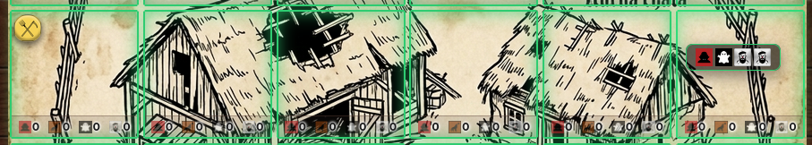
   *Opis:* Zestaw został wystawiony do brzegowego regionu planszy w odległości 5 od Jakuba. Punktacja za Wampiry to 4 - odległość, czyli Herszt Wampirów otrzymuje **-1 punkt**. Herszt Duchów otrzymuje 2 punkty minus odległość do krawędzi; ponieważ jest to region brzegowy: 2 - 0, czyli **2 punkty**. Herszt Bardaków otrzymuje po 1 punkcie za każdego swojego pionka wystawionego na planszę poza zasięgiem Jakuba. Zasięg Jakuba to 1, więc dostaje 2 x 1, czyli **2 punkty**.
2. 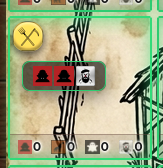
   *Opis:* Wampiry zostały umieszczone w regionie z Jakubem, czyli odległość wynosi 0. Herszt Wampirów punktuje po 4 punkty za każdego wampira (4 - 0 = 4 pkt za pionka), co daje **8 pkt**. Herszt Bardaków nie punktuje za Bardaków wystawionych do sektora Jakuba oraz sektorów z nim sąsiadujących, czyli otrzymuje **0 pkt**.
3. 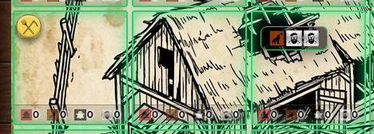
   *Opis:* Zestaw został wystawiony w odległości 2 od Jakuba. Herszt Wilkołaków otrzymuje **1 punkt**, ponieważ w regionie docelowym oraz sąsiednich nie ma innych Wilkołaków (za 1 wilkołaka zaokrąglając w dół otrzymuje 0 pkt, plus 1 pkt bazowy = 1 pkt). Nie otrzymuje też dodatkowego bonusowego punktu za bliskość Jakuba (odległość > 1). Herszt Bardaków znajduje się poza zasięgiem Jakuba (odległość > 1), więc otrzymuje po 1 punkcie za każdego Bardaka w zestawie, co daje **2 pkt**.
4. 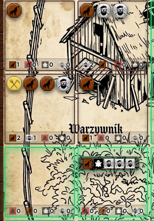
   *Opis:* Zestaw został wystawiony do regionu w odległości 1 od Jakuba. Herszt Bardaków otrzymuje **0 punktów**, ponieważ jest to sektor zagrożony (odległość ≤ 1). Herszt Duchów liczy odległość od krawędzi (wynosi ona 1), więc bazowo otrzymałby 2 - 1 = 1 pkt za ducha, ale z racji tego, że region znajduje się w zasięgu Jakuba, naliczana jest kara -1 pkt za każdego ducha, co daje ostatecznie **0 pkt**. Herszt Wilkołaków otrzymuje 1 punkt za wystawionego Wilkołaka, +1 punkt za bliskość Jakuba (odległość ≤ 1), oraz +1 punkt za to, że łącznie w regionie docelowym oraz sąsiednich znajdują się 4 Wilkołaki (za 4 wilkołaki zaokrąglając w dół otrzymuje 1 pkt). Ostatecznie daje to 1 (bazowy) + 1 (za bliskość) + 1 (za 4 wilkołaki) = **3 pkt**.
5. 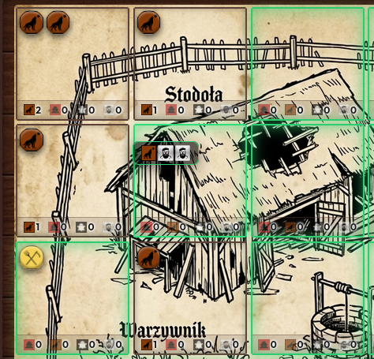
   *Opis:* Herszt bardaków nie dostaje żadnych punktów gdyż został wystawiony do regionu w zasięgu jakuba. Hersz wilkołaków dostaje. 1 punkt za wystawienie wilkołaka 1 punkt za region w zasięgu jakuba. Następnie zlicza wilkołaki w zasięgu sektora w którym został wystawiony jest ich 6 czyli dodatkowe 2 punkty. Łącznie 4 punkty.
6. 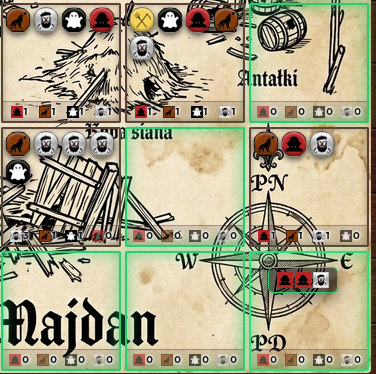
   *Opis:* Hersz bardaków 1 punkt gdyż jest to region poza zasięgiem Jakuba. Obecny sektor jest w odległości 2 od jakuba czyli każdy wampir dostej 4 -2=2pkt czyli łącznie 4pkt

## 6. Szczegółowe Zasady Ruchu i Walki Jakuba

W Fazie Jakuba jego ruch oraz ataki są w pełni zautomatyzowane i przebiegają według następujących reguł:

1.  **Czystka w obecnym sektorze:** 
    Zanim Jakub wykona jakikolwiek ruch, najpierw niszczy pionki w sektorze, w którym się aktualnie znajduje.
    *   Atakuje wyłącznie te bandy, na które ma **Furię większą niż 0**.
    *   Za każdego zabitego pionka danej bandy, jej Herszt traci **1 punkt**, a poziom Furii Jakuba na tę bandę **zmniejsza się o 1**.
    *   Czystka trwa dopóki w obecnym regionie są pionki band, na które Jakub ma Furię, lub dopóki Furia na te bandy nie spadnie do 0.

2.  **Poszukiwanie Celu i Ruch:**
    Jeśli Jakub wciąż posiada Furię, a w jego obecnym sektorze nie ma już pionków band, na które jest wściekły, decyduje się na ruch:
    *   Jakub wybiera jako cel bandę, na którą ma **najwyższy aktualny poziom Furii** (w przypadku remisu decyduje Hierarchia Band).
    *   Skanuje sektory w swoim aktualnym zasięgu ruchu w poszukiwaniu pionków tej docelowej bandy.
    *   **Wybór regionu docelowego (remisy):**
        1. Wybiera region w zasięgu z **największą ilością pionków docelowej bandy**.
        2. W przypadku remisu (kilka regionów ma tyle samo pionków tej bandy), wybiera region z **największą łączną liczbą wszystkich pionków** (dowolnych band).
        3. Jeśli nadal występuje remis, decyduje **Hierarchia Band** obecnych w tych regionach (wybierany jest ten z silniejszą bandą według hierarchii).
    *   Po wybraniu celu Jakub przemieszcza się do tego sektora. Każdy ruch zmniejsza jego aktualny zasięg o 1. Po przemieszczeniu się, Jakub natychmiast wykonuje czystkę (punkt 1) w nowym sektorze.

> [!NOTE]
> **Punkty Świadka Jakuba**
>
> Punkty te są przyznawane za odwagę pionków, które przetrwały spotkanie z Jakubem. 
> Tuż przed tym, jak Jakub opuści swój dotychczasowy sektor (rozpoczynając ruch do innego regionu), sprawdzane jest czy w opuszczanym sektorze pozostały jakieś pionki.
>
> Jeśli w sektorze znajdują się pionki bandy, na którą **Furia Jakuba wynosi dokładnie 0**, Herszt tej bandy otrzymuje **2 punkty** za każdy taki ocalały pionek.
> Punkty te są przyznawane także tym pionkom, które zostaną w regionie Jakuba po tym, jak furia na wszystkie bandy spadnie do 0.

### Przykład Fazy Jakuba

1. 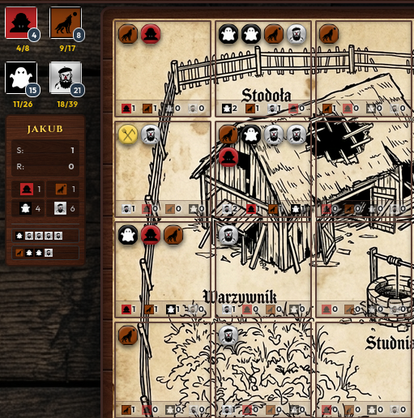
   *Opis 1:* Faza Jakuba zaczyna się od zabicia Bardaka na polu z Jakubem. Furia Jakuba na Bardaki spada o 1.

2. 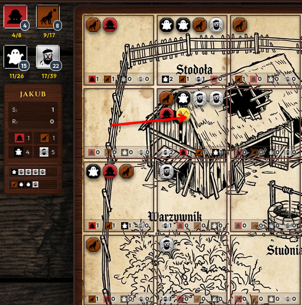
   *Opis 2:* Jakub najbardziej pała furią do Bardaków, więc szuka regionu z największą ilością Bardaków w jego zasięgu. Ponieważ żadna z nacji nie ma furii większej lub równej 10, jego zasięg to 1, więc przeskakuje do regionu w prawo.

3. 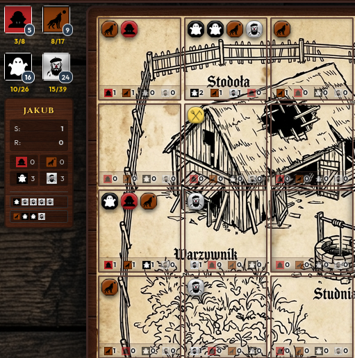
   *Opis 3:* Jakub zabił wszystkie pionki w regionie i została mu jeszcze furia.

4. 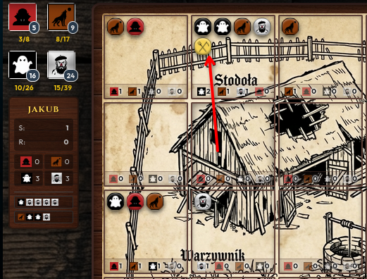
   *Opis 4:* Ponieważ ma tyle samo furii na Duchy i Bardaki, remis rozstrzyga Hierarchia Band: Wampiry -> Wilkołaki -> Duchy -> Bardaki. Szuka więc w sąsiedztwie regionu z największą ilością Duchów i będzie to region prosto w górę.

5. 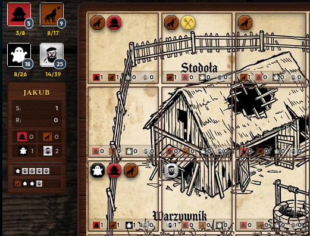
   *Opis 5:* Jakub zabił 2 Duchy i Bardaka. Jego obecna furia jest skierowana na Bardaki, ale ponieważ nie ma w zasięgu żadnego Bardaka, szuka kolejnej bandy (Duchów), jednak ich również nie ma. Jego faza furii się kończy. Ponieważ po wygaśnięciu furii na polu z Jakubem pozostał Wilkołak, gracz kontrolujący tę bandę otrzymuje Punkty Świadka Jakuba w wysokości 2 pkt za każdego członka bandy.

---
*Zasady te stanowią fundament logiki symulatora MASAKRA na Starym Majdanie.*
